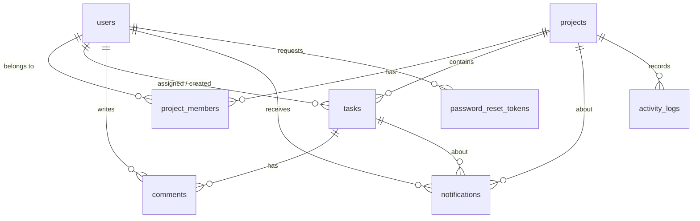

# Backend Design: Project Management Tool

Based on SRS v1.1 (6 October 2026) and the front-end design. This document fixes the
architecture, database, API and real-time events so the front end and back end can be built
against the same contract.

## 1. Stack

| Part | Choice |
| --- | --- |
| Runtime / framework | Node.js 18+, Express 4 |
| Database | PostgreSQL 13+ (plain SQL through `pg`, parameterized queries only: NFR-SEC-05) |
| Authentication | JWT (HS256) in the `Authorization: Bearer` header, passwords hashed with bcrypt (`bcryptjs`, cost >= 10) |
| Validation | zod, on the server for every request (NFR-SEC-04) |
| Real time | Socket.IO (rooms per project and per user) |
| Security | helmet, CORS limited to the front-end origin, JSON body limit 100 kb |

## 2. Architecture

Four layers per module (NFR-MNT-01). A layer only calls the layer below it.

```
routes      URL, HTTP method, middleware chain (auth, validation, project role)
controller  reads the request, calls one service function, writes the response
service     business rules, permissions, transactions, notifications, real-time events
repository  SQL only; takes an optional `db` (pool or transaction client)
```

```
src/
  app.js, server.js
  config/env.js                 environment variables (fails fast if one is missing)
  constants.js                  statuses, priorities, labels
  db/pool.js, db/sql.js         pool, withTransaction(), UPDATE builder, LIKE escaping
  middleware/                   auth, projectAccess, validate, errorHandler
  validation/schemas.js         every zod schema
  realtime/socket.js            Socket.IO server and emit helpers
  utils/                        permissions, mentions, progress, date, loginLimiter, mailer (all pure and tested)
  modules/
    auth/  users/  projects/  tasks/  comments/  notifications/
db/schema.sql, migrate.js, seed.js
tests/
```

Request flow for a protected project request:

```
authenticate  -> token valid? user still exists?           else 401
validate      -> params / query / body parsed by zod         else 400
loadProject   -> project exists? caller is a member?        else 404 / 403
requireManager (only where needed)                          else 403
controller -> service -> repository
```

Project roles are read from the database on every request and never from the token
(FR-AUTH-03, NFR-SEC-03).

## 3. Authorization

The permission matrix of SRS section 2.2 is implemented once, in `utils/permissions.js`, and
used by the services:

| Action | Rule in code |
| --- | --- |
| View project, tasks, comments | any member (`loadProject` / `loadTask`) |
| Create task | Manager, or Member when `members_can_create_tasks` is on (a Member may not set an assignee) |
| Edit, assign, delete task | Manager only (`requireManager`) |
| Change task status | Manager (any task) or the assignee (own task) |
| Post comment | any member |
| Edit comment | author only |
| Delete comment | author, or Manager (moderation) |
| Add / remove members, edit / delete project, settings | Manager only |
| Admin lists | `system_role = admin`; Admin is not automatically a project member |

Status codes: 400 invalid input, 401 not logged in, 403 not allowed, 404 not found (NFR-REL-03).
A project or task that exists but belongs to someone else gives 403, one that does not exist gives 404.

## 4. Database



Full DDL: `db/schema.sql`. Delete behaviour (NFR-REL-01, SRS data rules):

| When this is deleted | What happens (foreign key) |
| --- | --- |
| Project | members, tasks, comments, notifications, activity logs are deleted (CASCADE) |
| Task | its comments and notifications are deleted (CASCADE) |
| User | memberships, notifications, reset tokens deleted (CASCADE); tasks become unassigned and `created_by` becomes NULL; comments keep their text with `user_id` NULL, shown as "Deleted user" (SET NULL) |
| Project member removed | the service sets that member's tasks in the project to unassigned |

Integrity rules enforced by the database: unique email (case-insensitive index), exactly one Manager per
project (partial unique index), `CHECK` constraints on status, priority and roles. The rule "an assignee must
belong to the task's project" is enforced in the service inside the same request.

Indexes (NFR-PERF-04): `tasks(project_id, status)`, `tasks(assignee_id)`, `tasks(project_id, due_date)`,
`project_members(user_id)`, `comments(task_id, created_at)`, `notifications(user_id, is_read, created_at)`.

Extensions to the SRS table list: `projects.members_can_create_tasks` (FR-TASK-17, used by the settings page),
`notifications.project_id` (the list shows the project name and "added to project" has no task).

## 5. REST API

Base path `/api`. JSON in and out. Protected routes need `Authorization: Bearer <token>`.
Dates are `YYYY-MM-DD`, timestamps are ISO 8601. Ids are numbers.

### Auth

| Method and path | Who | Body | Success | Errors |
| --- | --- | --- | --- | --- |
| POST `/auth/register` | public | name, email, password | 201 `{user}` | 400, 409 `EMAIL_TAKEN` |
| POST `/auth/login` | public | email, password | 200 `{token, user}` | 400, 401 `INVALID_CREDENTIALS`, 429 |
| POST `/auth/logout` | user | | 204 | 401 |
| POST `/auth/forgot-password` | public | email | 200 `{message}` (same answer for any email) | 400 |
| POST `/auth/reset-password` | public | token, password | 200 `{message}` | 400 `INVALID_RESET_TOKEN` |

### Users

| Method and path | Who | Body | Success | Errors |
| --- | --- | --- | --- | --- |
| GET `/users/me` | user | | 200 `{user}` | |
| PATCH `/users/me` | user | name?, phone? | 200 `{user}` | 400 |
| PUT `/users/me/password` | user | currentPassword, newPassword | 204 | 400 `INVALID_PASSWORD` |
| DELETE `/users/me` | user | password | 204 | 400 `INVALID_PASSWORD`, 409 `MANAGES_SHARED_PROJECTS` (lists the projects), 409 `LAST_ADMIN` |
| GET `/admin/users` | admin | | 200 `{users}` (no phone numbers) | 403 |
| GET `/admin/projects` | admin | | 200 `{projects}` | 403 |

### Projects

| Method and path | Who | Body / query | Success | Errors |
| --- | --- | --- | --- | --- |
| GET `/projects` | user | `status`, `search` | 200 `{projects:[summary]}` | |
| POST `/projects` | user | title, description?, status?, endDate? | 201 `{project}` (creator is Manager) | 400 |
| GET `/projects/:projectId` | member | | 200 `{project}` with members | 403, 404 |
| PATCH `/projects/:projectId` | Manager | title?, description?, status?, endDate?, membersCanCreateTasks? | 200 `{project}` | 400, 403 |
| DELETE `/projects/:projectId` | Manager | | 204 | 403 |
| POST `/projects/:projectId/members` | Manager | email | 201 `{member}` | 404 `USER_NOT_FOUND`, 409 `ALREADY_MEMBER` |
| DELETE `/projects/:projectId/members/:userId` | Manager | | 204 | 400 `CANNOT_REMOVE_MANAGER`, 404 |
| GET `/projects/:projectId/dashboard` | member | | 200 `{dashboard}` | |
| GET `/projects/:projectId/activity` | Manager | | 200 `{activity}` | 403 |

Project summary (dashboard card): `id, title, description, status, endDate, myRole, counts{total,done,remaining},
progress, memberCount, members[first 3 {id,name}], createdAt`. Project detail adds `membersCanCreateTasks` and the
full `members[{id,name,role,email?}]` (email only for the Manager).

### Tasks

| Method and path | Who | Body / query | Success | Errors |
| --- | --- | --- | --- | --- |
| GET `/projects/:projectId/tasks` | member | `search`, `priority`, `status`, `assignee` (`me`, `none` or id), `mine=true`, `due` (`today`, `week`), `sort` (`board`, `priority`, `dueDate`, `name`) | 200 `{tasks}` | |
| POST `/projects/:projectId/tasks` | Manager (or Member if enabled) | title, description?, priority?, dueDate?, assigneeId? | 201 `{task}` | 400 `ASSIGNEE_NOT_MEMBER`, 403 |
| GET `/tasks/:taskId` | member | | 200 `{task, permissions}` | 403, 404 |
| PATCH `/tasks/:taskId` | Manager | title?, description?, priority?, dueDate?, assigneeId?, blockedReason? | 200 `{task}` | 400, 403 |
| PATCH `/tasks/:taskId/status` | Manager or assignee | status, blockedReason?, position? | 200 `{task}` | 400, 403 `STATUS_CHANGE_FORBIDDEN` |
| DELETE `/tasks/:taskId` | Manager | | 204 | 403 |

Task: `id, projectId, title, description, status, priority, assignee{id,name}|null, dueDate|null, isOverdue,
position, blockedReason|null, completedAt|null, createdBy{id,name}|null, commentCount, createdAt, updatedAt`.
All filters combine with AND. `position` places the card at that index in the target column when dragging.
`permissions` is `{canEdit, canDelete, canChangeStatus}` for the caller.

### Comments

| Method and path | Who | Body | Success | Errors |
| --- | --- | --- | --- | --- |
| GET `/tasks/:taskId/comments` | member | | 200 `{comments}` oldest first | 403 |
| POST `/tasks/:taskId/comments` | member | text (1 to 1000) | 201 `{comment}` | 400 |
| PATCH `/tasks/:taskId/comments/:commentId` | author | text | 200 `{comment}` | 403 |
| DELETE `/tasks/:taskId/comments/:commentId` | author or Manager | | 204 | 403, 404 |

Comment: `id, taskId, text, createdAt, updatedAt, edited, author{id,name,role}|null, canEdit, canDelete`.
`author: null` means "Deleted user".

### Notifications

| Method and path | Success |
| --- | --- |
| GET `/notifications?unread=true&limit=50` | 200 `{notifications, unreadCount}` |
| GET `/notifications/unread-count` | 200 `{unreadCount}` |
| PATCH `/notifications/:id/read` | 204 (404 if it is not yours) |
| PATCH `/notifications/read-all` | 204 |

Notification: `id, type, message, isRead, createdAt, taskId|null, projectId, projectTitle`. The UI links a
notification to `/projects/:projectId/tasks/:taskId`.

### Errors

```json
{ "error": { "code": "VALIDATION_ERROR", "message": "Password must be at least 8 characters",
             "details": [ { "field": "password", "message": "Password must be at least 8 characters" } ] } }
```

## 6. Notification rules

| Event | Who is notified | Type |
| --- | --- | --- |
| Task assigned (create or edit) | the new assignee | `assigned` |
| Comment posted | the task's assignee | `comment` |
| @Full Name in a comment | each mentioned member (the assignee then gets only the mention) | `mention` |
| Status changed | assignee and creator | `status_changed` |
| Added to a project | the added user | `added_to_project` |

Nobody is notified about their own action (FR-NOTIF-07). Notifications are written in the same database
transaction as the change, and pushed over WebSocket after the commit.

## 7. WebSocket (Socket.IO)

Connect with `io(API_URL, { auth: { token } })`. The server refuses a missing or invalid token and puts the
connection in the rooms of the projects the user belongs to, plus a private room for the user.
If the socket fails, the REST API keeps working (NFR-REL-02).

| Event | Payload |
| --- | --- |
| `task:created`, `task:updated` | `{projectId, actorId, task}` |
| `task:moved` | `{projectId, actorId, task, from, to}` |
| `task:deleted` | `{projectId, actorId, taskId}` |
| `comment:added`, `comment:updated` | `{projectId, taskId, actorId, comment}` (no per-user flags) |
| `comment:deleted` | `{projectId, taskId, actorId, commentId}` |
| `member:added` | `{projectId, actorId, member}` |
| `member:removed` | `{projectId, actorId, userId, unassignedTaskIds}` |
| `project:updated` | `{projectId, actorId}` (refetch the project) |
| `project:deleted` | `{projectId, actorId}` |
| `notification:new` | `{notification}` (only to the receiving user) |

The user who made the change also receives the event, so the client should ignore updates it already applied
(compare `actorId`, or merge by id).

## 8. Decisions on the SRS open issues

| Open issue | Decision |
| --- | --- |
| Token storage | Bearer header; the front end keeps the token in `localStorage` (simple, matches SRS 5.2). The API never relies on cookies, so there is no CSRF surface. Revisit with httpOnly cookies if XSS risk grows. |
| Password reset (Could) | Implemented; the link is printed to the server log until an email service is chosen (`utils/mailer.js`). |
| Members creating tasks by default | No (Manager only); per-project switch in settings. |
| Ownership transfer | Not added; deleting an account is refused while the user manages a shared project. |
| Capacity targets | Not load-tested; the schema and indexes are sized for 50 users and 20 members per project. |
| Hosting | Not chosen. The app is one Node process plus PostgreSQL; set `DATABASE_SSL=true` for hosted databases. |

Small refinements of SRS 5.2 (which left endpoints to the design stage): admin lists are under `/api/admin/...`,
comment edit and delete are under `/api/tasks/:taskId/comments/:commentId`, and password change is a separate
`PUT /users/me/password`.

## 9. SRS traceability

| SRS group | Where |
| --- | --- |
| FR-AUTH-01..07, NFR-SEC-01, 08 | `modules/auth`, `utils/loginLimiter.js` |
| FR-USER-01..04 | `modules/users` |
| FR-PROJ-01..12 | `modules/projects` |
| FR-TASK-01..18, FR-SRCH-01..04 | `modules/tasks` |
| FR-COMM-01..07 | `modules/comments`, `utils/mentions.js` (links in text are rendered by the front end) |
| FR-NOTIF-01..07 | `modules/notifications`, plus the services that create them |
| FR-RT-01..03 | `realtime/socket.js`, `GET /projects/:id/activity` |
| FR-DASH-01..05 | `projects.service.getDashboard` |
| FR-UI-* | front end |
| NFR-SEC-02..07 | helmet, token expiry, `middleware/*`, `validation/schemas.js`, parameterized SQL, `config/env.js`, CORS |
| NFR-REL-01..03 | foreign keys in `db/schema.sql`, `middleware/errorHandler.js` |
| NFR-PERF-04 | indexes in `db/schema.sql` |

## 10. Known limits

- Login rate limiting is in memory (one process). Use a shared store if the API runs on several instances.
- Tokens cannot be revoked before they expire (stateless logout). A short `JWT_EXPIRES_IN` limits the risk.
- Card positions inside a column are integers shifted on insert; there is no background re-numbering.
- Automated tests cover the pure rules (permissions, progress, mentions, limiter, dates). API tests against a real
  PostgreSQL database still need to be added.
